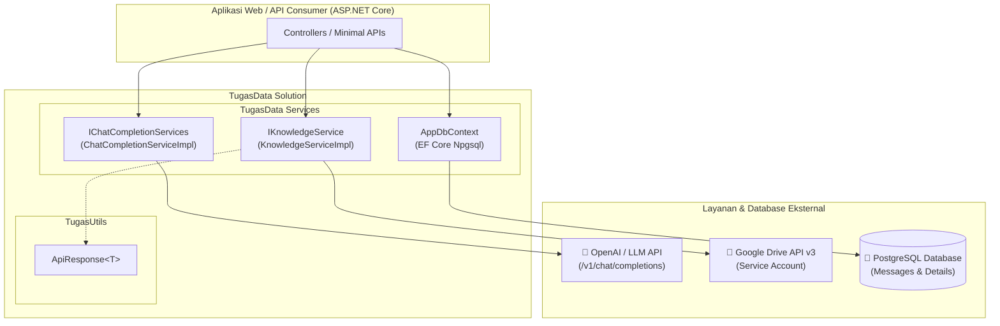

<div align="center">

# 🚀 ai-chatbot-datalayer

**Modern Data Access & External Service Integration Layer for AI Chatbot and Knowledge Management**

[](https://dotnet.microsoft.com/)
[](https://docs.microsoft.com/dotnet/csharp/)
[](https://www.postgresql.org/)
[](https://learn.microsoft.com/ef/core/)
[](https://platform.openai.com/)
[](https://developers.google.com/drive)
[](LICENSE)

<p align="center">
  Lapisan data (Data Layer) dan integrasi layanan eksternal berbasis .NET 8 untuk manajemen percakapan AI, penyimpanan riwayat pesan di PostgreSQL, dan integrasi knowledge base materi kuliah melalui Google Drive API.
</p>

</div>

---

## 📌 Daftar Isi

- [Tentang Proyek](#-tentang-proyek)
- [Arsitektur Sistem](#-arsitektur-sistem)
- [Fitur Utama](#-fitur-utama)
- [Struktur Direktori](#-struktur-direktori)
- [Prasyarat](#-prasyarat)
- [Panduan Instalasi & Konfigurasi](#-panduan-instalasi--konfigurasi)
- [Database & Migrasi EF Core](#-database--migrasi-ef-core)
- [Contoh Penggunaan Kode](#-contoh-penggunaan-kode)
- [Peningkatan & Best Practices](#-peningkatan--best-practices)
- [Lisensi](#-lisensi)

---

## 📖 Tentang Proyek

**TugasData** adalah pustaka kelas (Class Library) .NET 8 yang berfungsi sebagai fondasi backend untuk:
1. **Penyimpanan Pesan & Riwayat Chat**: Mengelola sesi obrolan (`Messages`) dan rincian pesan (`MessageDetail`) ke basis data PostgreSQL menggunakan **Entity Framework Core**.
2. **Integrasi LLM / OpenAI**: Menyediakan layanan komunikasi asinkron ke OpenAI Chat Completion API (atau model LLM lain yang kompatibel).
3. **Knowledge Base Service**: Mengambil dokumen dan materi pembelajaran dari folder Google Drive menggunakan **Google Drive API v3** dengan autentikasi Service Account.
4. **Shared Utilities (`TugasUtils`)**: Menyeragamkan respons API menggunakan format terstandar `ApiResponse<T>`.

---

## 🏗 Arsitektur Sistem



---

## ✨ Fitur Utama

- 🐘 **Entity Framework Core 9 + PostgreSQL**: Pemetaan relasi *one-to-many* antara percakapan (`Messages`) dan pesan individu (`MessageDetail`) dengan strategi migrasi otomatis.
- 🤖 **Thread-Safe LLM Chat Completion**: Mengirim pesan ke endpoint OpenAI dengan penanganan `HttpRequestMessage` per-request, bebas konkurensi race-condition.
- 📂 **Google Drive Knowledge Extraction**: Pencarian dokumen dalam folder tertentu berdasarkan ID folder, lengkap dengan metadata tautan web view.
- 🔄 **Standardized API Response**: Menggunakan wrapper generik `ApiResponse<T>` untuk konsistensi status sukses, pesan, data, dan penanganan error.
- 💉 **Ekstensi Dependency Injection**: Metode pendaftaran layanan yang bersih dan mudah digunakan di `Program.cs`.

---

## 📂 Struktur Direktori

```text
PerbaikiRepoGithub/
├── .github/                         # Workflow CI/CD (opsional)
├── TugasData/                       # Library Data & Service Layer
│   ├── ChatCompletionServices/     # Layanan integrasi OpenAI LLM
│   │   ├── Impl/                   # Implementasi ChatCompletionServiceImpl
│   │   ├── Model/                  # Request/Response model
│   │   └── IChatCompletionServices.cs
│   ├── Context/                    # EF Core DbContext & DI Extensions
│   │   ├── AppDBContext.cs         # Entity Framework DbContext
│   │   └── AppDBExtension.cs       # ServiceCollection extensions
│   ├── KnowledgeService/           # Layanan integrasi Google Drive
│   │   ├── Impl/                   # Implementasi KnowledgeServiceImpl
│   │   ├── Model/                  # Model metadata file & settings
│   │   └── IKnowledgeService.cs
│   ├── MessageDao/                 # Data Access Object / Entities
│   │   └── MessageDao.cs           # Entity Messages & MessageDetail
│   ├── Migrations/                 # Migrasi EF Core untuk PostgreSQL
│   └── TugasData.csproj            # Proyek .NET 8 SDK
├── TugasUtils/                      # Proyek Shared Utility
│   ├── HttpUtils/Model/            # Model helper HTTP
│   │   └── ApiResponse.cs          # Wrapper generic ApiResponse<T>
│   └── TugasUtils.csproj           # Proyek .NET 8 SDK
├── .gitattributes                   # Normalisasi line-ending Git
├── .gitignore                       # Mengabaikan file build (bin/obj) & secrets
├── appsettings.example.json         # Template konfigurasi aplikasi
├── LICENSE                          # Lisensi open-source (MIT)
├── README.md                        # Dokumentasi proyek
└── TugasData.sln                    # Visual Studio Solution File
```

---

## 🛠 Prasyarat

Sebelum menjalankan proyek ini, pastikan sistem Anda memiliki:

- [.NET 8.0 SDK](https://dotnet.microsoft.com/download/dotnet/8.0) atau versi lebih baru
- [PostgreSQL](https://www.postgresql.org/download/) (v14 atau lebih baru)
- Akun & API Key [OpenAI](https://platform.openai.com/)
- [Google Cloud Console](https://console.cloud.google.com/) Project dengan Google Drive API diaktifkan serta file Service Account JSON (jika menggunakan fitur Knowledge Base)

---

## ⚙️ Panduan Instalasi & Konfigurasi

### 1. Clone Repository

```bash
git clone https://github.com/astroxxii/test.git
cd test
```

### 2. Konfigurasi `appsettings.json`

Salin berkas `appsettings.example.json` menjadi `appsettings.json` pada proyek konsumer (Web API Anda):

```json
{
  "ConnectionMode": "Development",
  "ConnectionStrings": {
    "Development": "Host=localhost;Port=5432;Username=postgres;Password=your_password;"
  },
  "Database": {
    "AppDb": "Database=tugas_db;"
  },
  "OpenAI": {
    "ApiKey": "sk-proj-xxxxxxxxxxxxxxxxxxxx",
    "ApiUrl": "https://api.openai.com/v1/chat/completions",
    "Model": "gpt-4o-mini"
  },
  "GoogleDriveSettings": {
    "ApplicationName": "TugasApp",
    "ServiceAccountCredentialPath": "credentials/service-account.json",
    "FolderId": "1a2b3c4d5e6f7g8h9i0j",
    "DefaultCourseName": "Sistem Basis Data"
  }
}
```

---

## 🗄 Database & Migrasi EF Core

Untuk menerapkan skema basis data ke PostgreSQL, jalankan perintah EF Core CLI berikut:

```bash
# Pastikan tool dotnet-ef sudah terinstal
dotnet tool install --global dotnet-ef

# Menerapkan migrasi ke database yang ditargetkan
dotnet ef database update --project TugasData
```

Jika ingin menambahkan migrasi baru:

```bash
dotnet ef migrations add NamaMigrasiBaru --project TugasData
```

---

## 💻 Contoh Penggunaan Kode

### 1. Mendaftarkan Layanan pada `Program.cs`

```csharp
using TugasData.Context;

var builder = WebApplication.CreateBuilder(args);

// 1. Registrasi DbContext PostgreSQL
builder.Services.InjectAppDbRepo(builder.Configuration);

// 2. Registrasi Layanan OpenAI Chat Completion
builder.Services.AddChatCompletionService();

var app = builder.Build();
```

### 2. Memanggil Chat Completion Service

```csharp
using TugasData.ChatCompletionServices;
using TugasData.ChatCompletionServices.Model;

public class ChatController : ControllerBase
{
    private readonly IChatCompletionServices _chatService;

    public ChatController(IChatCompletionServices chatService)
    {
        _chatService = chatService;
    }

    [HttpPost("ask")]
    public async Task<IActionResult> Ask([FromBody] string prompt, CancellationToken ct)
    {
        var request = new ChatCompletionsRequestService
        {
            Messages = new List<ChatCompletionRequestService>
            {
                new("system", "Anda adalah asisten akademik yang ramah."),
                new("user", prompt)
            }
        };

        string reply = await _chatService.GetChatCompletionAsync(request, ct);
        return Ok(new { reply });
    }
}
```

### 3. Mengambil Knowledge Base dari Google Drive

```csharp
using Google.Apis.Auth.OAuth2;
using TugasData.KnowledgeService;
using TugasData.KnowledgeService.Impl;

// Inisialisasi Service
var credential = GoogleCredential.FromFile("credentials/service-account.json")
                                 .CreateScoped(Google.Apis.Drive.v3.DriveService.ScopeConstants.DriveReadonly);

IKnowledgeService knowledgeService = new KnowledgeServiceImpl(
    applicationName: "TugasApp",
    credential: credential,
    folderId: "YOUR_FOLDER_ID",
    courseName: "Sistem Basis Data"
);

var response = await knowledgeService.GetFileKnowledgeByFolderIdAsync();

if (response.Success)
{
    foreach (var file in response.Data!.knowledges)
    {
        Console.WriteLine($"Materi: {file.nama} | Link: {file.link}");
    }
}
```

## 📄 Lisensi

Didistribusikan di bawah Lisensi **MIT**. Lihat berkas [LICENSE](LICENSE) untuk informasi lebih lanjut.

---

<div align="center">
  Dikelola dengan ❤️ oleh <b>astroxxii</b>
</div>
